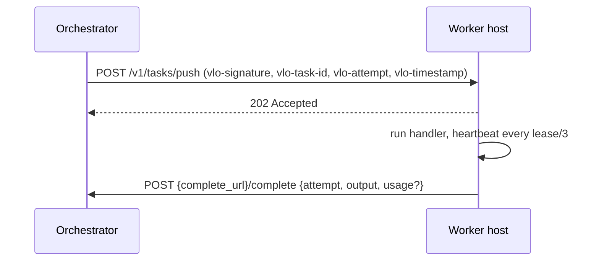

# Activities and workers

An **activity** declares a unit of non-deterministic work. A **worker** implements it. The
host sits between them: it validates inputs when a reducer asks for a task, validates
outputs when a worker reports one, and owns leases, retries and idempotency.

## Declaring an activity

```ts
import { z } from "zod";
import { activity } from "@oona/vlo";

export const work = activity("example.work", {
  input: z.object({ item: z.string() }),
  output: z.object({ upper: z.string() }),
  retry: { maxAttempts: 3, backoff: "exponential", initialMs: 1_000, maxMs: 600_000, factor: 2, jitter: "full" },
  queue: "default",
  leaseMs: 60_000,
  timeoutMs: 120_000,
});
```

| Option | Default | Meaning |
| --- | --- | --- |
| `input`, `output` | required | Zod schemas. Input is checked in `cmd.task`; output is checked by the host before the result is folded. |
| `retry.maxAttempts` | `3` | Total attempts. Retrying stops once `attempt >= maxAttempts`. |
| `retry.backoff` | `"exponential"` | `"fixed"` or `"exponential"`. |
| `retry.initialMs` | `1000` | Delay before attempt 2. |
| `retry.maxMs` | `600000` | Cap on the delay. |
| `retry.factor` | `2` | Multiplier per attempt. |
| `retry.jitter` | `"full"` | `"full"` picks a delay uniformly in `[0, base]` using the journaled `random`; `"none"` uses `base`. |
| `queue` | `"default"` | Which queue the task lands on. `cmd.task(…, { queue })` overrides per call. |
| `leaseMs` | `60000` | How long a worker holds an attempt before it must heartbeat. |
| `timeoutMs` | none | Wall-clock budget for one attempt. |

The delay for attempt `n` is `initialMs × factor^(n−2)` capped at `maxMs`, then jittered.
`schema_violation`, `user_cancel` and `nondeterminism_detected` are never retried.

### Changing the ask on a retry

A retry repeats the journaled input. When repeating the same ask would fail the same way —
a model looping inside a long prompt — wrap the handler with `withRetryInput`:

```ts
import { defineWorker, withRetryInput } from "@oona/vlo";

defineWorker({
  "brand.synthesize": withRetryInput(synthesize, (input, attempt) => ({ ...input, compact: attempt > 1 })),
});
```

Attempts after the first receive `shape(input, attempt)`. The journaled task input is
untouched and `attempt` is journaled, so the same attempt always sees the same input, and
nothing about replay changes. `shape` must be pure; its result is not re-validated against
the input schema. This lives on the worker rather than on `activity()` because workers
never see activity definitions (a pushed or pulled task carries only `{ name, schema_ref }`)
and `retry` is part of the content hash, where a function cannot go.

### What is in the content hash

`activity()` hashes `{ v, name, input, output, retry }` and exposes it as `hash` and
`schemaRef` (`name@hash`). `input` and `output` are the JSON Schemas *projected* by
`projectSchema`: annotation keywords (`$schema`, `$id`, `$comment`, `title`, `description`,
`examples`, `default`, `deprecated`, `readOnly`, `writeOnly`) are removed at every depth,
so a `.describe()` label or a `.default()` never re-versions an activity under live runs.
Anything that changes which values a schema accepts (`additionalProperties`, `enum`,
`minimum`, `anyOf`, …) stays in the hash. `v` is `SCHEMA_HASH_VERSION`; it moves only when
the projection rule itself changes. The `schema_ref` travels on every task and event, so a
run can span a schema change. `queue`, `leaseMs` and `timeoutMs` are deliberately outside
the hash: they are operational knobs, and tuning them must not version the schema under
live runs.

Signals hash `{ v, name, schema }` the same way. Every hash is registered in the journal's
`schemas` table when a host boots, with the *full* schema, annotations included, so forms
and validation see the descriptions the hash ignores.

The projection and the encoding are a protocol, not an SDK detail: an SDK in another
language must produce the same `schema_ref` for the same definition. The golden cases in
`fixtures/schema-hash/` are the contract; see
[kernel-protocol.md](./kernel-protocol.md#schema-hash).

## Implementing a worker

```ts
import { defineWorker } from "@oona/vlo";

export default defineWorker(
  {
    "example.work": async (input: { item: string }, ctx) => {
      ctx.reportUsage({ tokens: 120, costMicroUsd: 5 });
      return { upper: input.item.toUpperCase() };
    },
  },
  { queues: ["default"] },
);
```

`defineWorker(impls, { queues? })` maps activity names to handlers and says which queues
this process serves (default `["default"]`). The worker holds no schemas; the host validates.

### `TaskContext`

| Field | Meaning |
| --- | --- |
| `ctx.taskId` | `run_id:step_id`. |
| `ctx.runId` | The run the task belongs to. |
| `ctx.attempt` | 1-based attempt number. |
| `ctx.heartbeat()` | Extends the lease. Rejects once the lease is gone. Called for you every `max(1 s, leaseMs / 3)` while the handler runs; a refused heartbeat aborts `ctx.signal`. |
| `ctx.reportUsage({ tokens?, costMicroUsd?, cpuMs? })` | Accumulates spend for this attempt. Values are truncated to non-negative integers. Banked on success *and* failure, and surfaced to the reducer as `event.usage` and `event.usage_total`. |
| `ctx.signal` | `AbortSignal`. Aborted when the lease is lost, `timeoutMs` elapses, or the worker shuts down. |

A handler's return value must satisfy the activity's `output` schema. A throw fails the
attempt with `cause: "app_error"` and the retry policy decides what happens next.

### Outcomes of one attempt

| What happened | Recorded as | Retried? |
| --- | --- | --- |
| Handler returned a valid output | `succeeded` | — |
| Handler returned something the output schema rejects | `failed`, `schema_violation` | never |
| Handler threw | `failed` or `retrying`, `app_error` | per policy |
| `timeoutMs` elapsed (worker-side) | `timeout` | per policy |
| No heartbeat before the lease lapsed (host-side reaper) | `heartbeat_lost` | per policy |
| `dispatched_at + timeoutMs` passed and the worker never answered (host-side backstop) | `timeout` | per policy |
| No handler registered for the activity | `failed` | never |

Exactly one terminal result is accepted per attempt. A timeout, a throw and a late return
race for the same attempt; the first report wins and the others are dropped. A result for an
attempt that has already moved on returns `{ duplicate: true }` and changes nothing.

## Where workers run



### In-process

A worker exported from a module matched by `workers` (or any module the config loads) runs
inside the host when the host holds `worker:<queue>` for one of its queues. This is what
`vlo dev` does with no queue configuration.

### Push mode (default for remote queues)

The orchestrator's profile names the queue's URL and a shared secret:

```ts
queues: { llm: { url: "https://workers.example.com/v1/tasks/push", secret: env("VLO_PUSH_SECRET") } },
publicUrl: "https://vlo.example.com",
```

The worker side is another host holding the `worker:<queue>` role:

```ts
import { serve } from "@oona/vlo/host";

await serve({
  journal: process.env.DATABASE_URL!,
  workflows: [],
  workers: [llmWorker],
  roles: ["worker:llm"],
  auth: { pushSecret: process.env.VLO_PUSH_SECRET!, callbackToken: process.env.VLO_TOKEN! },
  port: 8080,
});
```

The push is a `POST` whose body is the `PushedTask` JSON:

```json
{ "task_id": "run_…:task#1", "run_id": "run_…", "step_id": "task#1", "attempt": 1,
  "activity": { "name": "example.work", "schema_ref": "example.work@…" },
  "idempotency_key": "run_…:task#1:1", "input": { "item": "a" },
  "lease_ms": 60000, "heartbeat_ms": 20000, "timeout_ms": 120000,
  "complete_url": "https://vlo.example.com/v1/tasks/run_…%3Atask%231" }
```

Headers: `vlo-task-id`, `vlo-attempt`, `vlo-timestamp` (epoch ms) and
`vlo-signature: v1=<hex>` where the hex is
`HMAC-SHA256(secret, "<task_id>.<attempt>.<timestamp>.<sha256(body)>")`. The receiver
rejects a timestamp more than 5 minutes off. `verifySignature(secret, headers, rawBody)`
and `signPush(...)` in `@oona/vlo/host` implement both sides.

How the orchestrator reads the worker's answer:

| Response | Meaning |
| --- | --- |
| `202` | Accepted; the result comes later on `complete_url`. |
| `200 { "output": … }` | Accepted, with the result inline. |
| `409` | Already seen (same `idempotency_key` in flight). Treated as accepted. |
| `401`, `403`, `408`, `429`, any `5xx`, timeout (5 s), socket error | Not now: deferred with backoff `1 s × 2^attempts`, capped at 60 s. |
| any other `4xx` | The worker rejected the task itself: failed with `schema_violation`, not retried. |

A worker written in any language does the same: verify the signature, answer `202`, then
call back on `complete_url` with a bearer token (`auth.token` of the orchestrator):

| Route | Body |
| --- | --- |
| `POST {complete_url}/complete` | `{ "attempt": 1, "output": …, "usage"?: { "tokens", "cost_micro_usd", "cpu_ms" } }` |
| `POST {complete_url}/fail` | `{ "attempt": 1, "error": "…", "retryable"?: true, "cause"?: "timeout", "usage"?: … }` |
| `POST {complete_url}/heartbeat` | `{ "attempt": 1 }` |

`complete_url` is only filled when the orchestrator knows its own `publicUrl`; without it a
pull worker falls back to its configured `baseUrl`.

### Pull mode

Set `mode: "pull"` on the queue and the dispatcher leaves its tasks alone. A worker asks:

```ts
import { runPullWorker } from "@oona/vlo/host";

await runPullWorker({
  baseUrl: "https://vlo.example.com",
  token: process.env.VLO_TOKEN,
  worker: mediaWorker,
  queues: ["media"],   // default: the worker's own queues
  waitMs: 20_000,      // long-poll hold; the host caps it at 25 s
  concurrency: 4,
  signal: controller.signal,
  onError: (error) => console.error(error),
});
```

Under the hood: `POST /v1/tasks/poll` with `{ queue, worker_id, wait_ms, max }` (max ≤ 10)
returns `{ tasks: PushedTask[] }`, already marked `running` with a lease. The host wakes an
open poll the moment a task for that queue is committed in the same process. Results go
back through the same three verbs. The loop backs off 1 s after a failed poll and resolves
after `signal` aborts once in-flight tasks have reported.

## Idempotency

Execution is at-least-once; recording is exactly-once.

* `task_id = run_id:step_id`; `idempotency_key = run_id:step_id:attempt`. A retry is a
  new attempt with a new key; a re-push of the same attempt carries the same key.
* The push route answers `409` while a key is in flight in that process. Across processes,
  or after a crash, a handler may run twice for one key: make it idempotent on
  `ctx.taskId + ctx.attempt` when the side effect matters.
* The first terminal result for an attempt wins; later ones are `{ duplicate: true }`.

## Leases, heartbeats and timeouts

* The lease starts at dispatch (`lease_until = now + leaseMs`). The SDK worker heartbeats
  automatically; a handler only needs `ctx.heartbeat()` if it runs somewhere the SDK is not.
* The orchestrator's reaper fails any `running` attempt whose lease lapsed with
  `heartbeat_lost`. Because heartbeats are automatic, this only happens when the worker
  process is gone, not when a handler is slow.
* `timeoutMs` is enforced twice: the worker aborts the handler (`ctx.signal`) and reports
  `cause: "timeout"`; the orchestrator reaps an attempt past `dispatched_at + timeout_ms`
  in case the worker never answers. Long tasks that should not be cut off simply leave
  `timeoutMs` unset and rely on the lease.
* `SHUTDOWN_GRACE_MS` (5 s): on `host.stop()` in-process handlers get this long to report
  before the journal closes.
