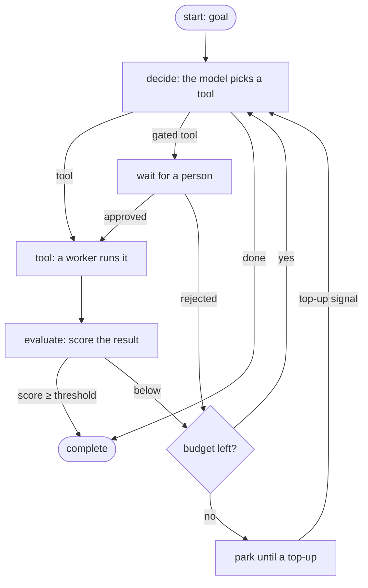

# Build an agent harness

An agent harness is the code around a model: it calls the model, runs the tools the model
picks, keeps memory, enforces a budget and waits for people. This guide builds one on Vlo
and shows what the engine gives you for free.

| A harness has to | On Vlo |
| --- | --- |
| Survive a crash on step 40 | Every decision, tool call and score is one journaled event. The run continues from the last one. |
| Stop a runaway agent | The kernel meters tokens and cost on every event. A spent budget parks the run. |
| Not lose work when it stops | A parked run keeps its memory and its best result, and resumes on a top-up. |
| Ask before a risky action | A gated tool waits for a person's yes or no. The run holds no compute while it waits. |
| Cope with bad model output | An unknown tool or invalid arguments becomes an observation, and the model decides again. |
| Run tools wherever they live | A tool is an activity. Its worker can be in-process, a serverless function or a Python service. |
| Show what happened | The journal is the trace: every step, retry and token is a row. |

The reference for every option is [agents.md](./agents.md).

**Everything on this page is runnable.** The code is
[`../examples/harness/`](../examples/harness/), which uses a scripted model so it needs no
API key. It is typechecked and tested in CI. From a checkout:

```sh
pnpm install                       # once, from the repository root
cd examples && pnpm dev:harness    # API on :4100
```

## How the loop works

`agentLoop` builds a decide → tool → evaluate loop as a reducer. Nothing loops at runtime:
each arrow below is one event folded into state.



## 1. Declare the tools

A tool is an ordinary activity with typed input and output. `activities.ts`:

<!-- snippet: examples/harness/activities.ts -->
```ts
export const search = activity("research.search", {
  input: z.object({ query: z.string() }),
  output: z.object({ results: z.array(z.string()) }),
});

export const write = activity("research.write", {
  input: z.object({ notes: z.string() }),
  output: z.object({ text: z.string() }),
});

export const publish = activity("research.publish", {
  input: z.object({ text: z.string() }),
  output: z.object({ url: z.string() }),
});

export const evaluate = activity("research.evaluate", {
  input: z.object({ goal: z.unknown(), candidate: z.unknown() }),
  output: z.object({ score: z.number() }),
});
```

`search` and `write` are safe to run unattended. `publish` reaches the outside world, so
step 3 puts a person in front of it.

## 2. Declare the decision

`decision` is the activity behind which your model call lives. Its output is fixed by the
tool registry, so the model can only name a tool the loop can run, or `"done"`.

<!-- snippet: examples/harness/activities.ts -->
```ts
export const decide = decision("research.decide", {
  input: z.object({
    goal: z.unknown(),
    memory: z.array(z.unknown()),
    candidate: z.unknown(),
    score: z.unknown(),
  }),
  tools: { search, write, publish },
});

export const topup = budgetTopup();
```

The decision returns `{ tool, args?, rationale?, final? }`.

## 3. Build the loop

`research.workflow.ts`:

<!-- snippet: examples/harness/research.workflow.ts -->
```ts
import { defineWorkflow } from "@oona/vlo";
import { agentLoop } from "@oona/vlo/agent";
import { decide, evaluate, publish, search, topup, write } from "./activities.ts";

export default defineWorkflow(
  "research",
  agentLoop({
    decide,
    tools: { search, write, publish },
    evaluate,
    threshold: 0.9,
    budget: { tokens: 50_000, costMicroUsd: 2_000_000 },
    topup,
    approval: { tools: ["publish"], timeoutMs: 172_800_000 },
    maxIterations: 30,
  }),
);
```

That is the whole agent:

- `budget` is the ceiling on what one run may spend.
- `threshold` is the score at which the run completes on its own.
- `approval` names the tools that wait for a person. Here a request that nobody answers in
  two days counts as a no.

## 4. Put the model in a worker

The worker is where the model call happens. Report what each call spent, so the budget
means something. `research.worker.ts`:

<!-- snippet: examples/harness/research.worker.ts -->
```ts
import { defineWorker } from "@oona/vlo";
import { decideNext, grade, post, webSearch, writeReport, type DecideInput } from "./model.ts";

export default defineWorker({
  "research.decide": async (input: DecideInput, ctx) => {
    const reply = await decideNext(input);
    ctx.reportUsage({ tokens: reply.tokens, costMicroUsd: reply.costMicroUsd });
    return { tool: reply.tool, args: reply.args ?? null, rationale: reply.why };
  },

  "research.search": async (input: { query: string }) => ({
    results: await webSearch(input.query),
  }),

  "research.write": async (input: { notes: string }, ctx) => {
    const reply = await writeReport(input.notes);
    ctx.reportUsage({ tokens: reply.tokens, costMicroUsd: reply.costMicroUsd });
    return { text: reply.text };
  },

  "research.publish": async (input: { text: string }) => ({
    url: await post(input.text),
  }),

  "research.evaluate": async (input: { goal: unknown; candidate: unknown }) => ({
    score: await grade(input.goal, input.candidate),
  }),
});
```

`decideNext`, `writeReport`, `webSearch`, `post` and `grade` live in
[`model.ts`](../examples/harness/model.ts). In the example they are scripted stand-ins; in
your harness they are your model client and your tools. Vlo does not ship a model client
and has no price table: `costMicroUsd` is whatever you report.

Usage is banked on failed attempts too, so a model call that times out and retries still
counts against the budget.

## 5. Run it

`vlo.config.ts`:

<!-- snippet: examples/harness/vlo.config.ts -->
```ts
import { defineConfig } from "@oona/vlo";

export default defineConfig({
  workflows: ["*.workflow.ts"],
  workers: ["*.worker.ts"],
  activities: ["activities.ts"],
  profiles: {
    dev: {
      journal: "sqlite://.vlo/harness.db",
      blob: "file://.vlo/blobs",
      roles: ["orchestrator", "api", "worker:default"],
      dispatcher: { mode: "loop" },
    },
  },
});
```

```sh
pnpm dev:harness
```

```ts
import { createClient } from "@oona/vlo/host";

const client = createClient({ baseUrl: "http://localhost:4100" });
const run = await client.start("research", { topic: "durable execution" });
```

The run input is the agent's goal. With the scripted model the agent searches, writes a
short report, then asks to publish it and waits. Step 9 answers it.

## 6. Watch it think

Follow the run live. Journal frames are durable, so reconnecting with the last `seq` loses
nothing.

```ts
for await (const message of client.stream(run.run_id)) {
  if (message.type === "journal") console.log(message.seq, message.data.step_id, message.data.status);
  if (message.type === "end") console.log("finished:", message.data.status);
}
```

Step ids tell you where the agent is: `decide#0`, `tool#0`, `evaluate#0`, `decide#1`, and so
on. After the run, `client.events(runId)` returns the same history, including each
attempt's `usage`. See [observability.md](./observability.md).

## 7. When the budget runs out

The run does not fail. Its status becomes `awaiting_signal`, it holds no compute, and it
keeps its memory and its best candidate.

```ts
const parked = await client.waitFor(run.run_id, "awaiting_signal");

// Somebody decides to keep going.
await client.signal(run.run_id, topup, { tokens: 20_000 });
```

- To find every parked run: `client.list({ status: "awaiting_signal" })`.
- To stop instead: `client.cancel(runId)`.
- To let a person approve the extra spend from an email, mint a signed link:
  `client.signalLink(runId, topup)`. See
  [signals-and-humans.md](./signals-and-humans.md#signed-links).

## 8. When the model misbehaves

The decider is a model, so bad output is an ordinary outcome, not a crash.

| The model | What the loop does |
| --- | --- |
| Names a tool that is not registered | Records the error as an observation and decides again. |
| Sends arguments the tool's schema rejects | Records `invalid args` as an observation and decides again. |
| Picks a tool that fails after its retries | Records the failure as an observation and decides again. |
| Returns no `tool` at all | Fails the run. |

Because each recovery is another iteration, it counts against `budget.steps` and
`maxIterations`. The agent cannot loop on a mistake forever.

## 9. Add a human approval

When the model picks a gated tool, the loop does not run it. The run's status becomes
`awaiting_signal`, it holds no compute, and it waits for a person.

Each gated call waits on its own signal, named after its iteration. The scripted agent asks
to publish on its third cycle, so the wait's step id is `approve#2` and `approvalSignal(2)`
answers it:

<!-- snippet: examples/harness/harness.test.ts -->
```ts
await client.signal(run.run_id, approvalSignal(2), { approved: true, by: "dana" });
```

The tool then runs as usual. To say no instead:

<!-- snippet: examples/harness/harness.test.ts -->
```ts
await client.signal(run.run_id, approvalSignal(2), { approved: false, reason: "not this week" });
```

A rejection is not a failure. The tool does not run, the reason goes into the agent's
memory as an observation, and the model decides what to do next.

To let someone approve from an email or a chat message, mint a signed link. Opening it
changes nothing; confirming the form approves that one call.

<!-- snippet: examples/harness/harness.test.ts -->
```ts
const link = await client.signalLink(run.run_id, approvalSignal(2), { expiresInMs: 86_400_000 });
```

What to know:

- **An approval is single-use.** Because each call has its own signal, a duplicate reply or
  an old link can never approve a later call.
- **To find what is being asked**, read the run's events for the open `approve#<i>` step, or
  listen on the `human` channel of the event stream, which carries the tool, its arguments
  and the model's rationale.
- **A reviewer cannot edit the arguments.** They approve or reject the call as the model
  made it.
- **With `timeoutMs`**, an unanswered request counts as a rejection. Set
  `onTimeout: "fail"` to fail the run instead.

To gate a whole result instead of one tool, run the agent as a child of a pipeline with a
`waitFor`; see [recipes.md](./recipes.md#wait-for-an-approval-with-a-deadline).

## 10. Run agents in parallel

Each agent is a run, so a team of agents is a fan-out of child runs with a concurrency
limit:

<!-- snippet: examples/recipes/recipes.ts -->
```ts
export const agents = fanOutRuns(
  "research",
  (state) => (state.input as { topics: string[] }).topics.map((topic) => ({ topic })),
  { concurrency: 4 },
);
```

Each child has its own journal, its own budget and its own usage total. A parent does not
see what its children spent; read each child's `output.spent`.

## 11. Move the model call off the host

A tool can run somewhere else without changing the workflow. Give the activity a queue and
point the queue at a worker:

```ts
export const decide = decision("research.decide", { input: …, tools: { search, write, publish }, queue: "llm" });
```

```ts
// in the production profile
queues: { llm: { url: env("VLO_QUEUE_LLM_URL"), secret: env("VLO_PUSH_SECRET") } },
```

The worker can be a serverless function that exists only while it works, or a service in
another language that verifies the signature and calls back. See
[activities-and-workers.md](./activities-and-workers.md#where-workers-run).

## What Vlo does not do for you

- **It does not call the model.** Bring your own client and prompts.
- **It does not price tokens.** You report cost; the kernel banks it.
- **It does not manage long context.** The loop keeps the last 20 observations
  (`memoryLimit`) and drops older ones. Summarise in a tool if you need more.
- **It does not roll child usage up to a parent.**

## Next

- [agents.md](./agents.md): every option, the state shape and the result shape.
- [testing.md](./testing.md#testing-an-agent): test the loop with a scripted model and no API key.
- [recipes.md](./recipes.md): short answers to common tasks.
