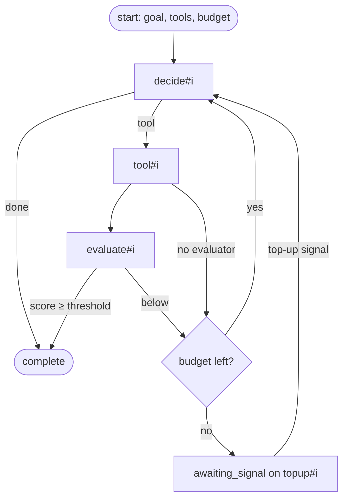

# Agents

`@vlo/agent` builds a decide → tool → evaluate loop as a pure reducer. Nothing loops at
runtime: every arrow is one journaled event folded into state, so an agent survives a crash
mid-thought and replays deterministically. The budget is a reducer decision over the usage
the kernel banks on each event; exhaustion parks the run on a signal instead of failing it.

```sh
pnpm add @vlo/agent @vlo/sdk zod
```



## The pieces

### `decision(name, { input, tools, retry?, queue?, timeoutMs? })`

An ordinary activity whose output schema is fixed by the tool registry, so an LLM worker is
constrained to names the loop can dispatch:

```ts
{ tool: "<one of tools>" | "done", args?: unknown, rationale?: string, final?: Json }
```

`"done"` is reserved: a tool named `done` throws at definition time. The worker behind it
is your model call.

### `agentLoop(options)`

Returns a `WorkflowDef<AgentState, Json>`; hand it to `defineWorkflow`.

| Option | Default | Meaning |
| --- | --- | --- |
| `decide` | required | The decider activity. Receives `{ goal, memory, candidate, score }`. |
| `tools` | required | `Record<string, Activity>`, keyed by the name `decide` returns. |
| `evaluate` | none | Scores a candidate. Receives `{ goal, candidate }`; returns a `number` or `{ score: number }`. |
| `threshold` | none | Score at or above which the run completes. Without one only `decide` can finish. |
| `budget` | required | `{ tokens?, costMicroUsd?, steps? }`. An absent ceiling never binds. |
| `topup` | `budgetTopup()` | The signal a parked agent waits on. |
| `maxIterations` | `50` | Completes with `exhausted: true` when reached. |
| `memoryLimit` | `20` | Observations kept in state; older ones are dropped. |

### `budgetTopup(name = "agent.budget_topup")`

A `SignalDef<{ tokens?, costMicroUsd?, steps? }>`. Each field is added to the matching
ceiling; a ceiling that was never set stays unbounded.

## Example

```ts
// agent.ts
import { z } from "zod";
import { activity, defineWorkflow } from "@vlo/sdk";
import { agentLoop, budgetTopup, decision } from "@vlo/agent";

export const draft = activity("agent.draft", {
  input: z.object({ topic: z.string() }),
  output: z.object({ text: z.string() }),
});

export const rewrite = activity("agent.rewrite", {
  input: z.object({ text: z.string() }),
  output: z.object({ text: z.string() }),
});

export const evaluate = activity("agent.evaluate", {
  input: z.object({ goal: z.unknown(), candidate: z.unknown() }),
  output: z.object({ score: z.number() }),
});

export const decide = decision("agent.decide", {
  input: z.object({
    goal: z.unknown(),
    memory: z.array(z.unknown()),
    candidate: z.unknown(),
    score: z.unknown(),
  }),
  tools: { draft, rewrite },
});

export const topup = budgetTopup();

export default defineWorkflow(
  "headline-agent",
  agentLoop({
    decide,
    tools: { draft, rewrite },
    evaluate,
    threshold: 0.9,
    budget: { tokens: 20_000, steps: 12 },
    topup,
    maxIterations: 20,
  }),
);
```

The worker is where the model lives. Report usage so the budget means something:

```ts
import { defineWorker } from "@vlo/sdk";

export default defineWorker({
  "agent.decide": async (input: { goal: unknown; memory: unknown[] }, ctx) => {
    const reply = await callModel(input);           // your LLM call
    ctx.reportUsage({ tokens: reply.tokens, costMicroUsd: reply.costMicroUsd });
    return reply.memory_is_good_enough
      ? { tool: "done", final: reply.best, rationale: reply.why }
      : { tool: "draft", args: { topic: reply.topic }, rationale: reply.why };
  },
  "agent.draft": async (input: { topic: string }, ctx) => { /* … */ return { text: "…" }; },
  "agent.rewrite": async (input: { text: string }) => ({ text: input.text.trim() }),
  "agent.evaluate": async (input: { candidate: { text: string } }) => ({ score: 0.8 }),
});
```

Register `decide`, `draft`, `rewrite`, `evaluate` as activities and `topup` as a signal on
the host (export them from a module the config loads, or pass `activities` / `signals` to
`createHost`).

## One iteration

Step ids are `decide#i`, `tool#i`, `evaluate#i` and `topup#i`, where `i` is the iteration.

1. **decide** — `cmd.task(decide, { goal, memory, candidate, score }, { id: "decide#i" })`.
   `candidate` and `score` are the last tool output and its score, or `null`.
2. On `done`: complete with `final ?? candidate`. Otherwise validate `args` against the
   chosen tool's input schema and dispatch `tool#i`.
3. **tool** — the output becomes `candidate` and an observation
   `{ tool, args, output }` in `memory`. With no `evaluate`, go to step 5.
4. **evaluate** — `cmd.task(evaluate, { goal, candidate }, { id: "evaluate#i" })`. The
   score is written onto that observation. `score >= threshold` completes the run.
5. **advance** — `iteration + 1`. At `maxIterations`, complete with `exhausted: true`. If
   `isExhausted(budget, spent, iteration)`, park. Else decide again.

`spent` is the run's `usage_total` as carried on the last event; the loop never keeps its
own tally. `steps` compares against the iteration count.

### Routing around trouble

The decider is a model, so bad output is an ordinary outcome, not a run failure:

| Situation | Effect |
| --- | --- |
| Tool task failed after its retries, or was cancelled | Observation `{ tool, error }`; decide again. |
| `decide` named a tool that is not registered | Observation `{ tool, error: 'unknown tool "…"' }`; decide again. |
| `args` fail the tool's input schema | Observation `{ tool, args, error: "invalid args: …" }`; decide again. |
| `decide` output has no string `tool` | `WorkflowFailure` — the run fails. |
| `evaluate` output has no numeric score | `WorkflowFailure` — the run fails. |
| A result for a step the loop is not waiting for | Ignored: same state, no commands. |

## Parking and top-ups

When a ceiling is reached the reducer emits
`cmd.emit("agent", { parked: { iteration, budget, spent, candidate, score } })` and
`cmd.awaitSignal(topup, { id: "topup#i" })`. The run's status becomes `awaiting_signal` and
it holds no compute.

```ts
// Somebody decides to keep going.
await client.signal(runId, topup, { tokens: 10_000 });
```

The grant raises the ceilings that were set and the loop decides again. A grant too small
to help parks again on the next iteration under a fresh step id. A top-up that arrives while
the run is not parked is ignored. Cancel the run instead if the answer is "stop":
`client.cancel(runId)`.

Signed links work here too: mint one for `agent.budget_topup` and the form's empty POST
grants nothing but resumes the loop — give the schema a default if you want a link click to
add budget. See [signals-and-humans.md](./signals-and-humans.md).

## State and result

`AgentState` (journaled as the run's state):

```ts
{ phase: "decide" | "tool" | "evaluate" | "parked" | "done", goal, iteration, memory: Observation[],
  candidate?, score?, pending?: { tool, args }, budget, spent: { cpu_ms, tokens, cost_micro_usd } }
```

`AgentResult` (the run's `output`):

```ts
{ candidate: Json, score?: number, iterations: number,
  spent: { cpu_ms, tokens, cost_micro_usd }, exhausted?: true }
```

`iterations` counts the cycle in flight when the loop finished on a verdict; on
`maxIterations` it is the ceiling itself.

Reference: [`../sdk/ts/agent/test/example.ts`](../sdk/ts/agent/test/example.ts) and
[`../sdk/ts/agent/test/e2e.test.ts`](../sdk/ts/agent/test/e2e.test.ts), and the runnable
[`../examples/agent/`](../examples/agent/).
