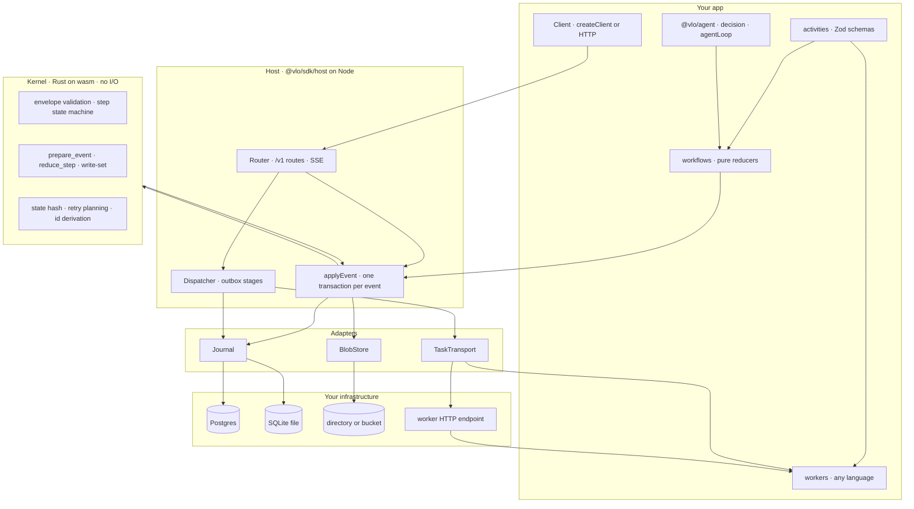
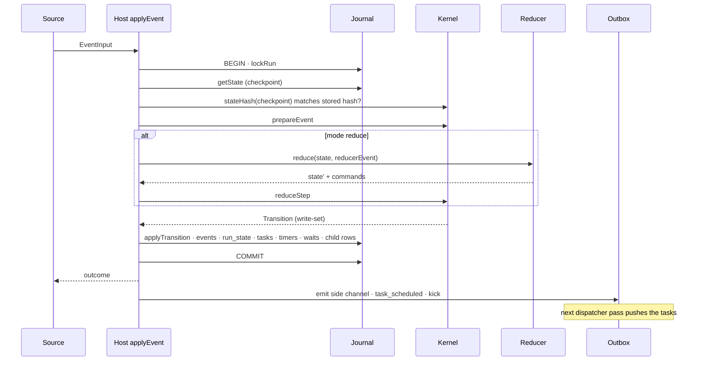
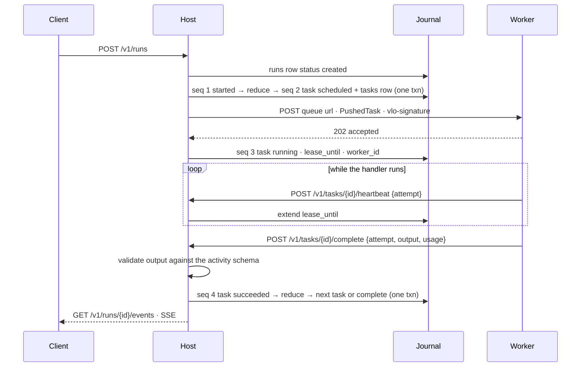

# Architecture

Five layers, three sequences, three roles. Source: `src/host/**`, `crates/**`.

## Layers

The kernel is closed: the five event kinds, seven statuses and seven commands cannot be
extended by a project. Everything above it is your code; everything below it is an adapter
with a small interface (`Journal`, `BlobStore`, `TaskTransport`).

## The write path

Every durable change goes through `applyEvent` (`src/host/transition.ts`): one transaction,
one event, one write-set.

Details that matter:

- The checkpoint is verified before folding. A missing checkpoint or a `bundle_digest` that
  differs from the run's pin is rebuilt from `seq 0` inside the same transaction.
- A reducer throw rolls the transaction back; the host then appends a `fail` marker whose
  payload is the event that was being folded, and the run is `failed`.
- A kernel refusal with code `unknown_step`, `already_terminal` or `bad_seq` is treated as a
  redelivery and answers `duplicate`; other refusals surface as `IllegalEvent`.
- Signals that were buffered before a wait existed are delivered as follow-up events right
  after commit.
- Cross-run effects never happen inside the fold. A `spawn` writes a `created` row; the
  outbox starts it in its own transaction. A closed child is noticed by the outbox and folded
  into the parent as a `child` event.

## The dispatcher

`Dispatcher` (`src/host/dispatcher.ts`) is the only thing that turns rows into effects. One
pass runs six idempotent stages, each claiming rows for `claimHoldMs` so several orchestrators
never do the same work:

| Stage | Claims | Produces |
| --- | --- | --- |
| start runs | `runs.status = 'created'` | the `started` event |
| push tasks | `tasks` scheduled and undispatched, not on a pull queue | a push to the queue's transport, then `task/running` + lease |
| fire timers | `timers` due and unfired | `timer/succeeded`; the fired flag and the event commit together |
| reap leases | `tasks` running with `lease_until_ms` in the past | `task/failed` or `task/retrying` with `cause: heartbeat_lost` |
| reap timeouts | `tasks` running past `dispatched_at_ms + timeout_ms` | the same with `cause: timeout` |
| notify parents | closed child runs not yet notified | a `child` event on the parent; a `continued` child is marked notified without one, because its successor carries the parent link |

In `loop` mode a pass runs every `tickMs` and on every `kick()` after a commit. In `manual`
mode nothing runs until `host.tick()`, `host.drain()` or `POST /v1/timers/tick`.

## The task lifecycle

Statuses a task step moves through: `scheduled` → `running` → `succeeded` | `failed` |
`retrying` (→ `scheduled` again on the next attempt) | `cancelled`. Execution is
at-least-once, recording exactly-once: the first terminal result for an attempt wins, a later
one answers `duplicate`. A worker that dies stops heartbeating; the lease reaper fails the
attempt with `heartbeat_lost` and the retry policy decides whether a fresh attempt (new
idempotency key, back in the outbox) or a final failure follows. A pull worker
(`POST /v1/tasks/poll`) enters the same sequence at the "202 accepted" point: the host records
`running` and the lease before handing the task out.

## Roles and processes

A process holds a subset of three roles; `createHost({ roles })` defaults to all of them plus
`worker:<queue>` for every in-process worker.

| Role | Owns | Routes it answers |
| --- | --- | --- |
| `orchestrator` | the dispatcher, `tick`, `drain` | `POST /v1/timers/tick` |
| `api` | the control plane | `/v1/runs/**`, `/v1/tasks/poll`, `/v1/tasks/{id}/*` |
| `worker:<queue>` | handlers for that queue, in-process and over inbound push | `POST /v1/tasks/push` |

Typical splits:

- **Laptop, CI, small self-host**: one process, every role, SQLite, file blobs.
- **Long-lived service plus workers**: `orchestrator` + `api` on one service; `worker:media`
  in containers that either receive pushes at a queue URL or run `runPullWorker`.
- **Serverless**: `orchestrator` + `api` + in-process workers in a route handler with
  `dispatcher: { mode: "manual" }`, a cron on the tick route, and `basePath` set to the mount
  point. Push queues can point at other functions.

Any process with `api` may accept a request for any run; only a process holding the
run's journal lock appends to it, one transaction at a time. Several `orchestrator` processes
may share a Postgres journal; a SQLite journal wants one.
