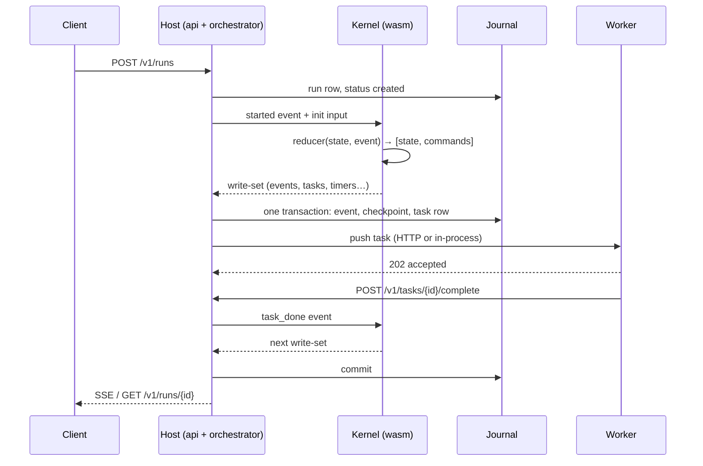

# Concepts

One model underlies everything: a run is a journal of events, a workflow is a pure function
that folds those events into state and asks for effects, and the host executes the effects.

## Vocabulary

| Term | Meaning |
| --- | --- |
| **Run** | One execution of a workflow. Has a `run_id`, a status, an ordered journal of events (`seq` 1, 2, 3…), and exactly one state checkpoint. |
| **Workflow** | A named reducer built with `defineWorkflow(name, { init, on })`. `init(input)` builds the first state; `on.<event>(state, event)` returns `[state, commands]`. |
| **Event** | Something that happened to a run: `started`, `task_done`, `signal`, `timer`, `child_done`. Every event carries `ts_ms`, 32 hex chars of journaled `random`, and the run's banked `usage_total`. |
| **Command** | What a reducer asks for: `task`, `timer`, `spawn`, `await_signal`, `emit`, `complete`, `continue_as_new`. Built with `cmd.*`; plain JSON. |
| **Step** | One unit of scheduled work inside a run, opened by a command: a task, a timer, a signal wait, a child run, or a marker. Identified by a `step_id` (`task#3`, or one you choose). |
| **Activity** | The declaration of a piece of non-deterministic work: a name, Zod input and output schemas, a retry policy, a queue. Content-hashed: `name@hash` is its `schema_ref`. |
| **Task** | A row in the journal that a worker executes to perform an activity. Has a `task_id` (`run:step`), an `attempt`, an `idempotency_key` (`run:step:attempt`), a lease and a retry policy. |
| **Signal** | A durable message into a run: a human reply, a webhook, a budget top-up. Declared with `signal(name, schema)`; delivered by `POST /v1/runs/{id}/signals/{name}`. Buffered if nothing is waiting yet. |
| **Timer** | A durable deadline. `cmd.timer({ ms })` parks the run; the host fires it as a `timer` event, exactly once. |
| **Child run** | A run started by `cmd.spawn`. When it ends, its parent receives `child_done` with the child's status and output. |
| **Journal** | Your Postgres database or a SQLite file. Holds runs, events, the state checkpoint, tasks, timers, signals. It is also the queue: there is no broker. |
| **Blob store** | A directory (`file://`) or a bucket (`gcs://`) for payloads over 256 KiB. The journal stores a `blob://sha256/<hex>` reference instead. |
| **Kernel** | The Rust state machine, compiled to wasm and loaded by the host. Validates events, calls your reducer, validates commands, and produces the write-set the journal applies. No I/O. |
| **Host** | The Node process around the kernel: opens the journal, serves HTTP, runs the dispatcher, runs in-process workers. `@oona/vlo/host`. |
| **Role** | What one host process does: `orchestrator`, `api`, `worker:<queue>`. A process may hold any subset. |
| **Worker** | Activity implementations: `defineWorker({ "name": handler })` plus the queues it serves. In-process, pushed to over HTTP, or polling. |
| **Profile** | One named deployment configuration in `vlo.config.ts`: journal, blob, roles, queues, auth, dispatcher mode, deploy target. |

## The loop

Every event goes through the same path: lock the run, load the checkpoint, fold, commit.
The dispatcher (the `orchestrator` role) reads committed rows on each tick and does the
effects: starts `created` runs, pushes `scheduled` tasks, fires due timers, reaps lapsed
leases and timeouts, and tells parents about closed children. A crash between "committed"
and "pushed" is recovered by the next tick, on any process holding the role.

## Statuses

Run status (`RunStatus`): `created` → `running` → `awaiting_signal` ⇄ `running` →
`completed` | `failed` | `cancelled` | `continued`. The last four are terminal; a run in a
terminal status accepts no further events.

Step status (`Status`): `scheduled`, `running`, `succeeded`, `failed`, `retrying`,
`cancelled`, `awaiting_signal`.

Failure cause (`Cause`): `timeout`, `heartbeat_lost`, `app_error`, `user_cancel`,
`schema_violation`, `nondeterminism_detected`. The last three are never retried.

## Roles

| Role | Owns |
| --- | --- |
| `orchestrator` | The dispatcher: the only thing that turns rows into effects. Also the `POST /v1/timers/tick` route. |
| `api` | The control plane: `/v1/runs…`, `/v1/tasks/{id}/complete\|fail\|heartbeat`, `/v1/tasks/poll`. |
| `worker:<queue>` | Runs activities on `<queue>`: in-process when the orchestrator is the same process, or via `POST /v1/tasks/push` from a remote one. |

With no `roles` configured a process holds `orchestrator`, `api` and `worker:<q>` for every
queue its workers declare. Splitting is a profile change; see [deployment.md](./deployment.md).

## Two ways a task reaches a worker

- **Push** (default). The dispatcher POSTs the task to the queue's URL with an HMAC
  signature; the worker answers `202` and reports later on `complete_url`. A queue with
  no URL is served only by a worker in the same process.
- **Pull**. `mode: "pull"` queues are never pushed. Workers long-poll
  `POST /v1/tasks/poll` and get the same task shape.

Both share one accept path: the task is marked `running` with a lease in the same
transaction as the hand-off, so the reaper and crash recovery see no difference.

## Determinism, briefly

A reducer must be pure: no clock, no randomness, no I/O. Every non-deterministic input
(`ts_ms`, `random`, task outputs, signal payloads) arrives on the event. The host hashes the
checkpoint on every load and rebuilds it from seq 0 when it is missing; a rebuilt state that
disagrees with the journal fails the run with `nondeterminism_detected`. Details in
[workflows.md](./workflows.md#determinism).

## Further reading

- [why-vlo.md](./why-vlo.md) — how the reducer compares with replay-based engines.
- [journal.md](./journal.md) — tables, dialects, the checkpoint.
- [kernel-protocol.md](./kernel-protocol.md) — the host ⇄ kernel calls.
- [architecture.md](./architecture.md) — how the pieces are laid out.
