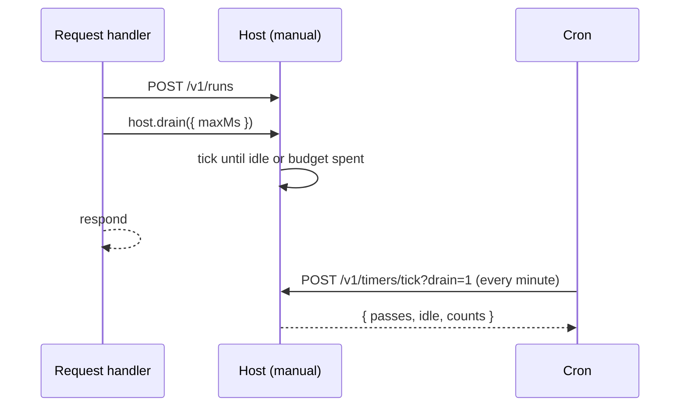

# Deployment

Vlo never owns infrastructure. A host is a Node process (or a serverless function) that
talks to your Postgres and, optionally, a bucket. `vlo deploy` renders the files your
pipeline applies; it applies nothing itself.

## The model

Three roles, any subset per process (see [concepts.md](./concepts.md#roles)):

- `orchestrator` — the dispatcher. Needs to tick: on an interval (`dispatcher.mode:
  "loop"`), or when something calls it (`"manual"`).
- `api` — the control plane and the worker callbacks.
- `worker:<queue>` — activity handlers, in-process or reached by push.

A laptop holds all three. A small self-host holds all three too. Splitting is a profile
change.

## Self-hosting on any Node host

Long-lived process, `loop` dispatcher:

```sh
VLO_PROFILE=prod PORT=8080 npx vlo serve
```

Or in code, with the same options the profile would produce:

```ts
import { serve } from "@oona/vlo/host";
import { workflows, workers, activities, signals } from "./vlo/index.ts";

const running = await serve({
  journal: process.env.DATABASE_URL!,
  blob: "gcs://my-bucket/vlo",
  workflows, workers, activities, signals,
  auth: { token: process.env.VLO_TOKEN!, pushSecret: process.env.VLO_PUSH_SECRET! },
  publicUrl: "https://vlo.example.com",
  port: Number(process.env.PORT ?? 8080),
});
// running.url, running.host, await running.close()
```

`serve()` binds `127.0.0.1` by default; pass `hostname: "0.0.0.0"` inside a container.
For your own listener, `createHost(options)` gives you `host.fetch: (Request) => Response`
plus `start()`, `stop()`, `tick()`, `drain()`.

Run more than one orchestrator freely: every dispatcher stage takes a claim, timers fire
exactly once, and reapers are idempotent.

## Serverless: manual dispatch

A function has no process to hang an interval on, so the orchestrator runs in
`dispatcher: { mode: "manual" }`: no timer, and `kick()` is a no-op. Progress comes from two
explicit sources.



- `Host.tick()` — one dispatcher pass. Returns
  `{ started, pushed, timers, reaped, timeouts, notified }`.
- `Host.drain({ maxMs })` — ticks until a pass moves nothing and no in-process handler is
  outstanding, or `maxMs` (default 25 s, wall clock) runs out. Returns
  `{ passes, idle, counts }`. Concurrent callers share one drain. Call it right after
  starting or signalling a run, inside the same invocation, so a chain of in-process steps
  finishes now instead of one step per cron tick.
- `POST /v1/timers/tick` — the same as `tick()` over HTTP (bearer). `?drain=1` runs
  `drain()`; `&max_ms=N` sets its budget. Served only by a process holding `orchestrator`.
- A cron hitting `POST /v1/timers/tick?drain=1` every minute is the backstop for
  invocations that died mid-drain, timers, retries and lease reaping.

Both `tick()` and `drain()` reject on a host without the `orchestrator` role.

### Who drains

With a manual dispatcher, "who drains" is a contract every caller must know. Keep it to one
rule: **the invocation that starts or signals a run drains once, after its response; the
cron tick is the backstop, never the plan.** In practice:

| Caller | Starts | Drains |
| --- | --- | --- |
| Request handler starting one run | `client.start` / `startFresh` | once, after the response (`after(() => host.drain({ maxMs }))`), with `maxMs` inside the route's own budget |
| Cron starting many runs | `client.start` per row with an idempotent `run_id`, inside the loop | **once, after the loop** — never per row |
| Script or test | `client.start` | `await host.drain()` inline; there is no "after the response" |
| Webhook delivering a signal | `client.signal` | once, after the response |

A cron that starts runs looks like this:

```ts
export async function POST(request: Request) {
  if (request.headers.get("authorization") !== `Bearer ${process.env.CRON_SECRET}`) return new Response(null, { status: 401 });
  const rows = await dueRows();
  for (const row of rows) {
    await client.start(weekly, { id: row.id }, { runId: `weekly_${row.id}_${isoWeek}` }); // idempotent per period
  }
  if (rows.length > 0) after(() => host.drain({ maxMs: 280_000 }));
  return new Response(null, { status: 202 });
}
```

Mounting under a framework route: `handler(options)` returns `{ GET, POST }` for a
catch-all route file and lazily creates one host per function instance. Pass `basePath`
(for example `"/api/vlo"`); the router strips it, and every URL the host hands out
(`complete_url`, signed links) includes it. `vlo doctor` warns when an orchestrator is in
`manual` mode and the profile has no `deploy.cron`.

## Splitting roles across services

Typical shape:

| Service | Roles | Notes |
| --- | --- | --- |
| Control plane | `orchestrator`, `api` | Long-lived (`loop`) or serverless (`manual` + cron). Needs `publicUrl` so pushed tasks carry a `complete_url`. |
| Push workers | `worker:<queue>` | Another host with `auth.pushSecret` and `auth.callbackToken`; the control plane's profile lists the queue `url` + `secret`. |
| Pull workers | none | Any process running `runPullWorker({ baseUrl, token, worker })`; the queue is `mode: "pull"`. |

All services share the journal URL. Every control-plane route needs `auth.token`; workers
present it on callbacks.

An application with several areas registers each as a domain instead of four flat arrays:

```ts
import { defineDomain } from "@oona/vlo";
import { createHost } from "@oona/vlo/host";

export const brand = defineDomain({ name: "brand", workflows: [research, weekly], workers: [brandWorker], activities, signals });
const host = createHost({ journal, domains: [brand, media, ideas], queues: { media: { mode: "pull" } } });
```

`createHost` flattens the domains onto `workflows`, `workers`, `activities` and `signals`
(both forms may be mixed) and derives `worker:<queue>` roles from the workers as before.
Two domains with one name, or two different definitions under one workflow or activity
name, are refused at construction. Details in
[activities-and-workers.md](./activities-and-workers.md#where-workers-run).

## Postgres

Before the first boot the app's role needs `CREATE` on the database (or a DBA-provisioned
`vlo` schema it owns); see [journal.md](./journal.md#privileges-the-postgres-role-needs).

Any Postgres works, including one behind a transaction-mode pooler: the journal holds no
session state and takes no session-level locks. A run is serialised with a
transaction-scoped advisory lock (`pg_advisory_xact_lock`) inside the single transaction
that folds its event, and outbox claims use `FOR UPDATE SKIP LOCKED`. Use the pooled
connection string on serverless. The host migrates on start and needs `CREATE` on its
schema. See [journal.md](./journal.md).

SQLite is for one process: a single writer, one file. Use it for `vlo dev`, tests and
single-node self-hosting.

## What `vlo deploy` renders

`vlo deploy --profile <name> [--out deploy/vlo] [--apply]` reads `profiles.<name>.deploy`
and writes files; `--apply` prints the commands to run. Secrets never appear in any file.
Names follow `<namePrefix>-<env>-<service>` (defaults `vlo-<env>-vlo`); the field reference
is in [configuration.md](./configuration.md#deploy).

### `target: "cloud-run"`

| File | Goes to | What it is |
| --- | --- | --- |
| `cloud-run/Dockerfile` | keep | Two-stage `node:22-alpine` image. Builds `@oona/vlo`, copies `vlo.config.ts` and `src/`, sets `VLO_PROFILE`, exposes 8080, `CMD vlo serve --profile <name>`. |
| `cloud-run/cloudbuild.yaml` | keep | build → push → `gcloud run deploy`, parameterised by `_SERVICE`, `_REGION`, `_REPO`. |
| `cloud-run/cloud-run-vlo.tf` | `terraform/` | Per-env (`for_each` over `envs`) Cloud Run v2 service, service account, Secret Manager *containers* for `DATABASE_URL`, `VLO_TOKEN`, `VLO_PUSH_SECRET`, IAM bindings, `allUsers` invoker (the bearer token is the gate), `min_instance_count = 1` so the loop dispatcher keeps ticking, image under `lifecycle.ignore_changes`. Outputs `vlo_urls`. |
| `cloud-run/cloudbuild-vlo.tf` | `terraform/` | Artifact Registry repo, a deployer service account, one Cloud Build trigger per env on `main`; `prod` gated on manual approval. |
| `cloud-run/README.md` | keep | The one-time setup: connect the repo to Cloud Build, copy the `.tf` files, add one secret *version* per env with `gcloud secrets versions add`, `terraform apply`, push. |

The Terraform expects a root module that already declares `local.envs` (with a `prefix`
per env), `local.env_buckets`, `var.project_id`, `var.github_owner`, `var.github_repo` and
the `google_project_service` enablements. Secret versions are deliberately not in Terraform:
a value in state is a value in every plan output.

`--apply` prints, in order: copy the `.tf` files, `terraform apply -target` for the secret
containers, `gcloud secrets versions add <namePrefix>-<env>-<secretName>-{database-url,token,push-secret}`
for each env, `terraform apply`, and the first `gcloud builds submit`.

### `target: "vercel"`

| File | Goes to | What it is |
| --- | --- | --- |
| `vercel/route.ts` | `app/api/vlo/[[...path]]/route.ts` | `export const { GET, POST } = handler({ … })` with `basePath: "/api/vlo"`, `dispatcher: { mode: "manual" }`, the profile's roles and push queues, `maxDuration = 300`. Imports `workflows` and `workers` from two barrels you provide (`@/vlo/workflows`, `@/vlo/workers`), because globs cannot be bundled into a function. |
| `vercel/vercel-crons.json` | merge into `vercel.json` | `{ "crons": [{ "path": "/api/vlo/v1/timers/tick", "schedule": "<cron>" }] }`. Only rendered when the profile holds `orchestrator`. |
| `vercel/env.md` | keep | Checklist of variables to set on the project. |

Variables the route reads: `DATABASE_URL` (pooled), `VLO_TOKEN`, `VLO_PUSH_SECRET`,
`VLO_PUBLIC_URL`, one `VLO_QUEUE_<NAME>_URL` per push queue, `VLO_BUCKET` when a bucket is
configured, and `GCP_SERVICE_ACCOUNT_KEY_BASE64` for a `gcs://` blob store off Google
infrastructure. Without a bucket the blob store falls back to `file:///tmp/vlo-blobs`,
which does not survive between invocations.

`--apply` prints: copy the route, `vercel env add <NAME> production` per variable, merge the
crons file, `vercel deploy --prod`.

## Checklist before the first deploy

1. `vlo doctor --profile <name>` with the production variables exported locally.
2. `publicUrl` set on any host that pushes tasks or mints links.
3. `auth.token` set: the control plane is reachable from the internet in both templates.
4. On serverless, a cron on `POST /v1/timers/tick?drain=1`, and `drain()` after each write
   in your own handlers.
5. Workers registered for every queue: in-process, a push `url` + `secret`, or pollers.
