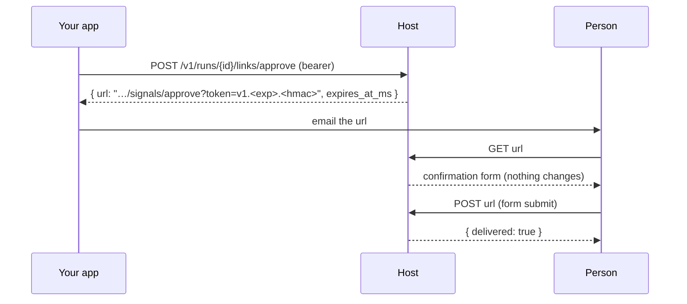

# Signals and humans

A signal is a durable message into a run. A human is a signal: a parked run holds no
compute while it waits, and resumes the moment the reply lands.

## Declaring a signal

```ts
import { z } from "zod";
import { signal } from "@vlo/sdk";

export const approve = signal("example.approve", z.object({ by: z.string() }));
```

`signal(name, schema)` returns a `SignalDef` with `name`, `hash`, `schemaRef`
(`name@hash`) and `schema`. Register it on the host (`signals: [approve]` in `createHost`,
or export it from a module the config loads) and the host validates every incoming payload
against it; an invalid payload is a `400`. An unregistered name is accepted as opaque JSON.

## Waiting for one

```ts
on: {
  started: (state) => [state, [cmd.awaitSignal(approve, { id: "gate", timeoutMs: 3_600_000 })]],
  signal: (state, event) =>
    event.step_id === "gate"
      ? [{ ...state, approvedBy: (event.payload as { by: string }).by }, [cmd.complete(null)]]
      : [state, []],
}
```

`cmd.awaitSignal(def, { id?, timeoutMs? })` opens a `signal` step and moves the run to
`awaiting_signal`. When a matching signal arrives the reducer gets a `signal` event with
`step_id`, `name` and `payload`.

Buffering: a signal that arrives before any wait is open is stored and delivered as soon as
a wait with that name opens. The `POST` reports `delivered: false` in that case, and also
when the matching wait has already closed (its deadline fired, or the run ended): such a
late signal is recorded but never reaches the reducer.

In a `sequence`, use `waitFor`:

```ts
sequence([
  step(plan),
  waitFor(approve, { timeoutMs: 86_400_000, onTimeout: "continue", context: { ask: "approve?" } }),
  step(finish, (state) => ({ approvedBy: signalOf(state, approve)?.by ?? "nobody" })),
])
```

| Option | Effect |
| --- | --- |
| `timeoutMs` | Races the wait against a deadline timer the kernel opens as `<id>:timeout`. |
| `onTimeout: "fail"` (default) | The deadline fails the run with `human timeout: <name>`. |
| `onTimeout: "continue"` | The deadline stores `null` under `signals[name]` and advances. |
| `context` | Emitted on the `human` channel so a UI can render the ask. |

Whichever arrives first wins and the kernel cancels the loser in the same transition, so
the reducer sees exactly one of the two. A signal that arrives after the deadline is not
delivered (`delivered: false`); a timer row left behind by a delivered signal is retired
by the dispatcher without reaching the reducer.

## `cmd.awaitHuman`

`waitFor` is built on `cmd.awaitHuman(def, { id, timeoutMs?, context? })`, which returns an
array of commands to spread into a reduction:

1. `await_signal` with step id `id` and `timeoutMs`, so the kernel opens the deadline timer
   `${id}:timeout` (`signalTimeoutStepId(id)` builds that string);
2. `emit("human", { signal, id, context })` when `context` is given.

```ts
started: (state) => [state, [...cmd.awaitHuman(approve, { id: "ask", timeoutMs: 60_000, context: { cut: state.cut } })]],
timer: (state, event) =>
  event.step_id === "ask:timeout" ? [state, [cmd.complete({ approved: false })]] : [state, []],
```

The `human` emit is not journaled. It reaches listeners on the host's `events` emitter and
any open SSE stream (`event: emit`). A client that connects later reads the run's status
(`awaiting_signal`) and the signal wait from the journal instead.

## Delivering a signal

```sh
curl -X POST https://vlo.example.com/v1/runs/run_…/signals/example.approve \
  -H 'authorization: Bearer …' -H 'content-type: application/json' \
  -d '{"by":"dc"}'
# {"signal_id":"sig_…","delivered":true}
```

```ts
const result = await client.signal(runId, approve, { by: "dc" });
// result.delivered is false when the signal was buffered
```

`client.signal(runId, nameOrDef, payload)` accepts a string or a `SignalDef`. Signals are
accepted while the run is `running` too: they buffer until the next wait opens.

An inbox is a query: `GET /v1/runs?status=awaiting_signal` (or
`client.list({ status: "awaiting_signal" })`).

## Signed links

A signed link is a URL that delivers one named signal to one run without a bearer token —
the thing you put in an email or a chat message.



### Minting

```ts
const link = await client.signalLink(runId, approve, { expiresInMs: 86_400_000 });
// { url: "https://vlo.example.com/v1/runs/run_…/signals/example.approve?token=v1.1760000000000.9f…", expires_at_ms: 1760000000000 }
```

`POST /v1/runs/{id}/links/{name}` with an optional body `{ "expires_in_ms": N }` (default 7
days) requires the bearer token. The URL is built from the host's `publicUrl` (falling back
to the request origin) and `basePath`.

Token format: `v1.<expires_at_ms>.<hmac>` with
`hmac = HMAC-SHA256(secret, "<run_id>.<name>.<expires_at_ms>")` in hex. It authorises
exactly that `(run, signal)` pair until that instant; a leaked token cannot start a run,
read a journal or signal anything else.

### Secret

Links are signed with `auth.linkSecret`, falling back to `auth.token`, then
`auth.pushSecret`. With none of the three configured, minting answers `503 links_disabled`.
`linkSecret` and `callbackToken` are `createHost` options; the config-file profile only
carries `token` and `pushSecret`.

### Using the link

- `GET …/signals/{name}?token=…` renders a small HTML confirmation form and changes
  nothing, so mail scanners and link previews cannot signal a run. The form POSTs the same
  URL.
- `POST …/signals/{name}?token=…` delivers the signal. The body is the payload; a browser
  form sends none, so a signal meant for links needs a schema that accepts an empty payload
  (`z.unknown()`, or an object with only optional fields).
- A tampered, expired or wrong-pair token falls through to the bearer check and gets the
  same `401` as no credential at all.

## Client summary

| Method | Route |
| --- | --- |
| `client.signal(runId, name, payload)` | `POST /v1/runs/{id}/signals/{name}` |
| `client.signalLink(runId, name, { expiresInMs? })` | `POST /v1/runs/{id}/links/{name}` |
| `client.list({ status: "awaiting_signal" })` | `GET /v1/runs?status=awaiting_signal` |
| `client.waitFor(runId, "awaiting_signal")` | polls `GET /v1/runs/{id}` |

See [http-api.md](./http-api.md) for the full route reference.
