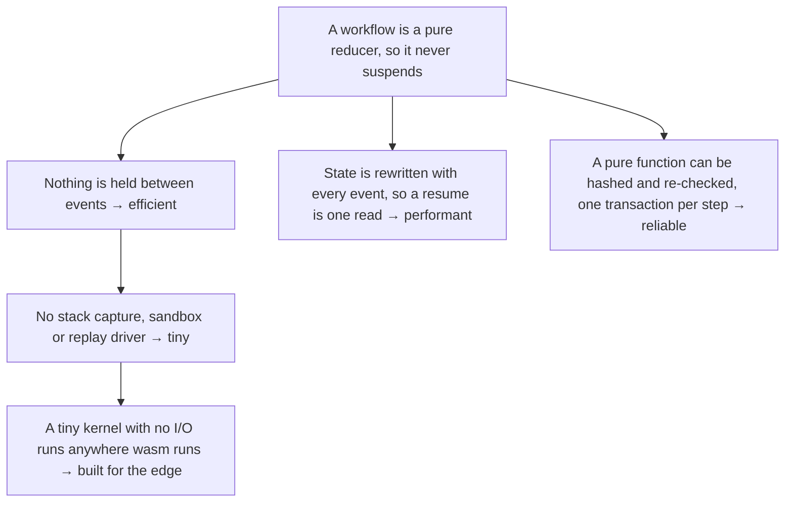

# Why Vlo

Vlo is durable execution that is tiny, performant, reliable, efficient and built to run at
the edge. This page explains what each of those buys you, why one design principle makes
all five possible, and what Vlo does not have yet.

## What durable execution costs today

Durable execution keeps long-running work alive through crashes. It usually makes you pay
five costs that have nothing to do with your product.

| Cost | What it looks like |
| --- | --- |
| **Heavy** | The engine is a server cluster, a large server binary or a hosted state store, and often a message broker as well. |
| **Slower as runs grow** | Engines that resume by re-running the workflow from the top do more work on each resume as a run's history grows. |
| **Fragile resumes** | That re-run must behave identically every time. One clock read or random number in the wrong place breaks recovery, and you find out in production. |
| **Tied to one place** | A platform engine runs on one cloud. A server engine needs machines in a region you operate. Either way the engine decides where your work lives. |
| **Costly while idle** | A cluster runs whether or not there is work, and waiting workflows often hold a worker or a slot. |

## The five benefits

### Tiny

Vlo is small enough to be a library in your app instead of a system beside it.

* **298 KB kernel.** Rust compiled to wasm, 297,573 bytes. With the Node host it is under
  600 KB. CI fails the build if the kernel passes 1 MiB or the runtime JavaScript passes
  256 KB. See [limits.md](./limits.md#size-budgets-ci-gate).
* **Nothing to stand up.** There is no server, no cluster and no broker. You add a package
  and point it at a database.
* **A closed model.** Five event kinds, seven commands and seven statuses. That is the
  whole programming model, and projects cannot extend the kernel.
* **A small surface for you, too.** One config file, four CLI verbs, three adapters, and a
  hello-world in three files.

### Performant

Vlo's speed comes from doing little work per step, and the amount of work does not grow
with the run.

* **One transaction per step.** The event, the new state and the next tasks commit
  together. There is no second system to coordinate with.
* **Constant-cost resume.** State is rewritten with every event, so waking a run is: load
  one row, verify its hash, continue. A run with 20,018 events resumed in the same time as
  a run with 38.
* **No broker hop.** A task is a row committed with the event. A worker in the same process
  skips HTTP entirely, and a polling worker is woken the moment a task is written.
* **Small rows.** Payloads over 256 KiB move to a content-addressed blob store, so the
  journal stays light.

The measured numbers, their setup and their limits are in [performance.md](./performance.md).

### Reliable

A crash at any point loses nothing, and wrong state cannot pass unnoticed.

* **Commit before acknowledge.** Nothing is confirmed to a caller or a worker until it is
  in the journal.
* **A transactional outbox.** Tasks, timers and child runs are rows written with the event.
  A crash between "saved" and "sent" is picked up on the next pass by any node.
* **Leases and heartbeats.** A worker that dies stops heartbeating, the lease lapses, and
  the retry policy decides what happens next.
* **State that checks itself.** Every checkpoint carries a hash that is verified on every
  load. A run rebuilt from its journal is compared step by step, and a mismatch fails the
  run at the exact event.
* **Recovery never depends on re-running your code.** Vlo resumes from stored state.
  Reducers must still be pure, but a mistake shows up as a failed rebuild, not as a
  silently different run.

The full list of guarantees, and what each one does not promise, is in
[reliability.md](./reliability.md).

### Efficient

Vlo uses resources only while a step is actually running.

* **Waiting is free.** Between events a run holds no compute, no open connection and no
  suspended stack. A run waiting two days for an approval is about 2 KB of rows.
* **Workers scale to zero.** Tasks are pushed over HTTP, so workers can be serverless
  functions that exist only while they work.
* **No infrastructure tax.** The journal is the Postgres you already run, and it is also
  the queue.
* **One process to start.** Orchestrator, API and workers are roles of a single process.
  You split them only when load calls for it.
* **Efficient with model spend.** The kernel meters tokens and cost on every event,
  including failed attempts. An agent that reaches its budget parks until someone tops it
  up. See [agents.md](./agents.md).
* **Efficient with your time.** One command for local development on a SQLite file, with no
  Docker and no cloud account, and generated deploy files for Cloud Run and Vercel.

### Built for the edge

Vlo is designed so the engine goes to the data, instead of the data going to the engine's
cluster.

* **A kernel with no I/O.** It only decides. It returns a write-set of rows and the host
  writes them, so it runs anywhere wasm runs: a container, a serverless function, a laptop.
* **A run lives where its journal lives.** One journal and one writer per run gives total
  order with no consensus protocol.
* **One durability model.** Commit before acknowledge, everywhere. The edge is a place to
  deploy, never a weaker tier.

**Status: the edge host is not built yet.** Today Vlo runs on Node: Cloud Run, Vercel, a
container or a laptop. A Cloudflare host with a Durable Object journal is the next platform
milestone. Nothing in the kernel needs to change to get there, but until it ships, do not
plan on running Vlo in an edge runtime. See [status.md](./status.md).

## One design principle

A Vlo workflow is one pure function:

```
(state, event) → (state, commands)
```

1. Something happens to a run: it started, a task finished, a signal arrived, a timer
   fired, or a child run ended. That is an event.
2. The kernel appends the event to the run's journal and hands it to your reducer with the
   current state.
3. The reducer returns the new state and a list of commands: run a task, set a timer, start
   a child run, wait for a signal, emit, complete, or continue as a new run.
4. The event, the new state and the commands are saved in one database transaction.
5. The host carries the commands out, pushing tasks to workers and firing timers.

The five benefits are one chain of consequences from that function:



Three phrases carry the idea:

* **State is the snapshot.** There is exactly one checkpoint per run, rewritten with every
  event. Recovery loads it, checks its hash and carries on.
* **The journal is the queue.** A task is a row committed in the same transaction as the
  event that asked for it.
* **Nothing suspends.** No function is ever paused mid-line, so there is no stack to save
  and no code to re-run.

## How this differs from other designs

Every durable engine must answer one question: when the process dies halfway, how does the
work continue? There are four answers.

| Model | How progress survives a crash | What it asks of you |
| --- | --- | --- |
| **Replayed code** | The workflow function runs again from the top. Recorded step results are replayed, so it fast-forwards to where it stopped. | Deterministic workflow code. Replay work grows with history. Mistakes are caught after the fact. |
| **State-machine definition** | The workflow is data, not code. The service stores the current state. | Logic in JSON or YAML. Branches and loops are verbose. |
| **Snapshotted runtime** | The whole runtime instance is checkpointed and resumed. | A server that owns the runtime, and large snapshots. |
| **Event-sourced reducer** (Vlo) | Each event is folded into a state snapshot inside one transaction. There is nothing to replay. | Workflows written as pure reducers, or with the `sequence` helper. No `await` inside a workflow. |

The first three keep the same assumption: a workflow is a running program that must be
paused and brought back. They differ in how they bring it back. Vlo drops the assumption.
A workflow is never running, so it never needs to be paused, saved or resumed. It is only
ever asked one question: given this state and this event, what next?

## The trade

You give up writing a workflow as straight `await a(); await b();` code. In exchange,
recovery never depends on re-running that code.

The `sequence` helper covers linear pipelines, so most workflows read as a list of steps:

```ts
sequence([step(plan), fanOut(work, selectItems, { concurrency: 2 }), waitFor(approve), step(finish)]);
```

An agent loop is one call to `agentLoop`. Reducers are plain functions, so you unit test
them with no engine running. See [workflows.md](./workflows.md) and [testing.md](./testing.md).

## What Vlo does not have yet

Check this list before choosing it.

* **No console.** There is no web UI with a run tree. Vlo has the journal, a live event
  stream, the HTTP API and the CLI. See [observability.md](./observability.md).
* **Workflows are TypeScript only.** Workers can be written in any language; the reducer
  runs in the Node host.
* **No managed cloud.** You run the host. `vlo deploy` renders the Cloud Run or Vercel
  files, but nobody operates it for you.
* **No edge host.** The Cloudflare host and Durable Object journal are planned, not built.
* **Nothing enforces reducer purity.** A TypeScript reducer is a plain function, so it
  could read the clock or call the network, and no lint catches that today. A mistake
  surfaces only when a run is rebuilt from its journal.
* **Benchmarks are local only.** One laptop, with the database on the same machine. There
  is no production or large-scale figure yet.
* **Known weak spots.** A step makes about 15 database round trips, so the host must sit
  beside its journal. One run that fans out very wide slows down sharply; wide work belongs
  in child runs. See [limits.md](./limits.md#known-weak-spots).
* **It is young.** Older engines have years of production history that Vlo does not.

## When to pick it

Pick Vlo when:

* you want durable workflows and agents without operating a server;
* your Postgres is already the system of record you trust;
* workers live in more than one language or more than one place;
* idle cost matters, because your runs spend most of their life waiting;
* you want agents with budgets that park instead of fail.

Pick a different engine when your team writes long linear workflows and wants them to read
as plain `await` code, or when you need a console and a support contract on day one.

Next: [getting-started.md](./getting-started.md), or the common objections in
[faq.md](./faq.md).
